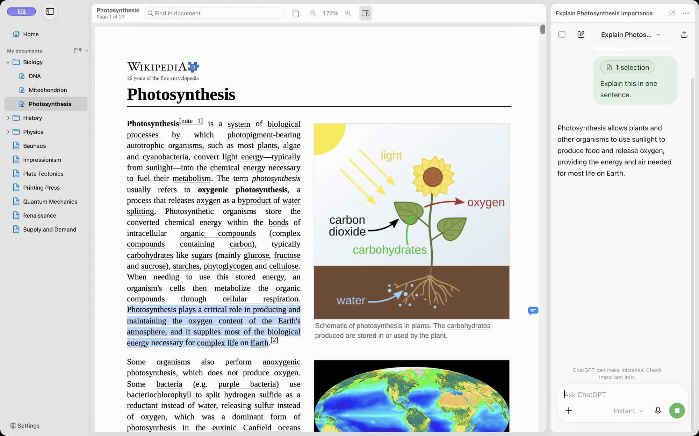

<p align="center">
  
</p>

<h1 align="center">Folio</h1>

<p align="center">
  A small PDF reader for Mac with a chat panel beside the page.<br>
  Select a passage, ask about it with the page number attached, and keep reading.
</p>

<p align="center">
  <a href="https://github.com/alexmodrono/folio/releases/latest"></a>
  &nbsp;
  <a href="https://pdf.amodrono.com/quickstart/"></a>
</p>

<p align="center">
  <sub>For macOS 26 and later. Uses your own ChatGPT account. Not affiliated with OpenAI.</sub>
</p>

<p align="center">
  <a href="https://github.com/alexmodrono/folio/actions/workflows/ci.yml"></a>
  <a href="https://github.com/alexmodrono/folio/actions/workflows/codeql.yml"></a>
</p>



## What it does

- **Ask about a passage.** Select text and press ⌘L. The passage waits above the message box, labeled with the document and page, and you send the question yourself.
- **Ask about a whole page.** For figures, tables and formulas, Folio attaches an image of the page.
- **Find your questions again.** Pages you asked about get a small bubble in the margin that jumps back to the question in the chat.
- **A folder, not a database.** Your library is a plain folder, `~/Documents/Folio` by default. If you use [Findle](https://github.com/alexmodrono/Findle), your Moodle courses show up in the sidebar.
- **A native reader.** Single page, continuous, two pages or book mode, thumbnails, find and zoom, built with AppKit and PDFKit.

The chat panel is chatgpt.com, signed in with your own account. Folio fills in the message box but never sends anything for you, and opening a PDF never uploads it. The guides at **[pdf.amodrono.com](https://pdf.amodrono.com)** cover everything in detail.

## Install

Download `Folio-<version>.dmg` from [Releases](https://github.com/alexmodrono/folio/releases/latest), open it and drag Folio to Applications. Releases are signed with a Developer ID and notarized by Apple. Folio checks for updates once a day and installs them when you agree.

## Build from source

Needs Xcode 27 and [XcodeGen](https://github.com/yonaskolb/XcodeGen) (`brew install xcodegen`).

```sh
scripts/build.sh            # Debug build into build/Products/Debug/Folio.app
scripts/run.sh              # build and launch the Debug app, logs in the terminal
scripts/test.sh             # unit tests
```

See [CONTRIBUTING.md](CONTRIBUTING.md) for how the app is put together, the rules the chat panel follows, and how releases are made.

## Privacy

Folio has no accounts, servers, analytics or tracking. What you send in the chat panel goes to OpenAI under their terms. The only other request Folio makes on its own is a daily update check against this repository's latest release, which you can turn off in Settings. Details: [pdf.amodrono.com/privacy](https://pdf.amodrono.com/privacy/).

## Problems

Use **Help › Report a Problem…** in the app, or [open an issue](https://github.com/alexmodrono/folio/issues).

---

<sub>Folio is an independent app. It is not affiliated with, endorsed by, or sponsored by OpenAI. ChatGPT and OpenAI are trademarks of OpenAI. Your use of ChatGPT in Folio is subject to OpenAI's Terms of Use.</sub>
